# Keymaps

My Colemak Mod-DH QMK keymaps for two 34/36-key split boards from Bastard KB:

- [Charybdis Nano](aktersnurra/charybdis) (3x5, trackball)
- [Dilemma](aktersnurra/dilemma) (3x5_3, touchpad)

Both share the same layers. The [Ferris Sweep](aktersnurra/ferris) keymap is
retired and no longer maintained.

## Layers



The Dilemma has the same layers plus a Repeat key (sends the last key again) on
its extra, outer right thumb and RGB keys on Fun: see
[its README](aktersnurra/dilemma). Small labels under a key
are what it does when held; the highlighted key is the one holding the layer.

- **Base:** Colemak Mod-DH. The home row holds Gui, Alt, Ctrl and Shift on both
  hands; the thumbs hold the Nav, Sym and Num layers.
- **Sym:** shifted symbols sit on the bottom row, mostly right below their
  unshifted pair (`` ` `` → `~`, `-` → `_`, `=` → `+`, `[` → `{`, `'` → `"`).
- **Nav:** the pointer switches to sniping (slow, precise) while Nav is held.
  On the Charybdis, hold **Scroll** to scroll with the trackball. **å, ö, ä**
  sit on the right pinky column (see [Swedish letters](#swedish-letters)).
- **Num:** hold the Enter or Space thumb on top of Num for **Media** or **Fun**.
- **Fun:** the most used F-keys are on the home row: F1–F3 (with **CtlAlt** for
  Ctrl+Alt+F1–F3), F11 and F12. **Boot** reboots into the bootloader and
  **EeClr** clears the EEPROM. **TT−/TT+/TT?** tune the tapping term (see
  below).

The images are generated from the keymaps with
[keymap-drawer](https://github.com/caksoylar/keymap-drawer): run `./draw.sh`
after changing a keymap.

## Home-row mods

Tuned to avoid accidental modifiers while typing:

- **Chordal Hold:** a home-row key is only a modifier when the next key is on
  the other hand. Thumb keys count as either hand, so Gui+Enter or Ctrl+Esc
  work from the left hand too.
- **Flow Tap (150 ms):** while typing quickly, home-row keys always tap. Shift
  is exempt so capitals mid-sentence still work.
- **Permissive Hold:** a deliberate mod+key press registers without waiting.
- **Tapping term:** 250 ms for home-row keys, 180 ms for thumb keys.
- **Caps Word:** hold both Shift keys (T and N) to type in capitals until the
  end of the word.

### Tuning the tapping term

`TT−` and `TT+` change the home-row term by 5 ms, and `TT?` types the current
value. Changes are lost on unplug. Once you settle on a value, set
`TAPPING_TERM` in each board's `config.h`.

## Swedish letters

The å, ö and ä keys on Nav type the letters while the computer stays on a US
layout, so there's no layout switching. The keyboard detects the computer's OS
and uses its own input method:

- **macOS:** Option+A for å and Option+U then A/O for ä/ö. Needs the ABC or
  U.S. input source; nothing else to set up.
- **Linux:** Right Alt+W/Q/P, which needs the `altgr-intl` variant of the US
  layout: `setxkbmap -layout us -variant altgr-intl`. It's identical to plain
  US apart from Right Alt.

Hold the left Shift (T) for Å, Ä and Ö. The right Shift (N) can count as a
same-hand roll with these keys and type an n instead.

## Building

The keymaps build against the [Bastard KB QMK fork](https://github.com/Bastardkb/bastardkb-qmk)
on the `bkb-master` branch, with [Bastard KB's userspace](https://github.com/Bastardkb/qmk_userspace)
as the overlay. Stay on `bkb-master`: `main` removes the Dilemma's sniping and
DPI code.

One-time setup, from the directory that holds the three repositories:

```sh
git clone -b bkb-master https://github.com/Bastardkb/bastardkb-qmk
git clone https://github.com/Bastardkb/qmk_userspace
uv tool install qmk   # or: doas pacman -S qmk
qmk config user.qmk_home=$PWD/bastardkb-qmk user.overlay_dir=$PWD/qmk_userspace
(cd bastardkb-qmk && qmk git-submodule)

ln -s $PWD/keymaps/aktersnurra/charybdis \
  qmk_userspace/keyboards/bastardkb/charybdis/3x5/keymaps/aktersnurra
ln -s $PWD/keymaps/aktersnurra/dilemma \
  qmk_userspace/keyboards/bastardkb/dilemma/3x5_3/keymaps/aktersnurra
```

Then build with:

```sh
qmk compile -kb bastardkb/charybdis/3x5 -km aktersnurra
qmk compile -kb bastardkb/dilemma/3x5_3 -km aktersnurra
```

The `.uf2` files land in `qmk_userspace/`. Don't use `qmk userspace-compile`:
it builds the `vendor` keymaps listed in `qmk_userspace/qmk.json`, not these.

To flash, run `./flash.sh charybdis` or `./flash.sh dilemma`; see each
board's README for the steps.

## Layout of this repository

```
flash.sh             build and flash both halves of a board
draw.sh              regenerate the layer images
keymap-drawer.yaml   key labels for the images
images/              generated layer images
aktersnurra/
├── charybdis/       keymap.c, config.h, rules.mk
├── dilemma/         keymap.c, config.h, rules.mk
├── ferris/          retired
└── sftrp.c          ")" / Shift tap dance, used only by the Ferris keymap
```
