# Charybdis Nano

Keymap for the Bastard KB Charybdis Nano (3x5 with a trackball on the right
half). Layers and home-row mod behaviour are described in the
[main README](../../README.md).



## Board-specific settings

- **Trackball:** default DPI starts at 500 (step 200). Sniping DPI starts at
  100 (step 100) and is on while **Snipe** is held. Hold **Scroll** on Nav or
  Mouse to scroll with the ball. Moving the ball less than 20 counts doesn't
  turn on the Mouse layer (`AUTO_MOUSE_THRESHOLD`).
- **Thumbs:** three keys on the left, two on the right.

## Building

```sh
qmk compile -kb bastardkb/charybdis/3x5 -km aktersnurra
```

This writes `bastardkb_charybdis_3x5_aktersnurra.uf2` to `qmk_userspace/`. See
the [main README](../../README.md#building) for the one-time setup.

## Flashing

From the repository root:

```sh
./flash.sh charybdis
```

It builds the firmware, asks for your `doas` password while the keyboard still
works, then walks you through the halves one at a time. For each half, plug the
USB cable into it and enter the bootloader: press **Boot** (hold Tab, then
Space, then press Q) or double-tap the reset button. Once a half is in the
bootloader, the script flashes it with no typing needed.

Each half is built knowing which side it is, so the layout no longer flips when
the cable is in the left half, even after **EeClr**.

**The first time you use the script,** the left half still runs the old
firmware and its layout is flipped, so use its reset button instead of the
Boot key.
