# Dilemma

Keymap for the Bastard KB Dilemma (3x5_3 with a Cirque touchpad on the right
half). Layers and home-row mod behaviour are described in the
[main README](../../README.md).



## Board-specific settings

- **Touchpad:** default DPI starts at 256 (step 32). Sniping is on while
  **Snipe** is held. Moving less than 20 counts doesn't turn on the Mouse layer
  (`AUTO_MOUSE_THRESHOLD`). Circular scrolling is enabled: trace a circle along the
  edge of the pad to scroll.
- **Thumbs:** three keys on each side. The extra, outermost right thumb key is
  Repeat: it sends the last key again.
- **RGB:** toggle and cycle effects from the Fun layer.
- **Encoders (if fitted):** the board's defaults apply: scroll on the left,
  volume on the right.

## Building

```sh
qmk compile -kb bastardkb/dilemma/3x5_3 -km aktersnurra
```

This writes `bastardkb_dilemma_3x5_3_aktersnurra.uf2` to `qmk_userspace/`. See
the [main README](../../README.md#building) for the one-time setup.

## Flashing

From the repository root:

```sh
./flash.sh dilemma
```

It builds the firmware, asks for your `doas` password while the keyboard still
works (Linux only; macOS needs no password), then walks you through the halves one at a time. For each half, plug the
USB cable into it and enter the bootloader: press **Boot** (hold Tab, then
Space, then press Q) or double-tap the reset button. Once a half is in the
bootloader, the script flashes it with no typing needed.
